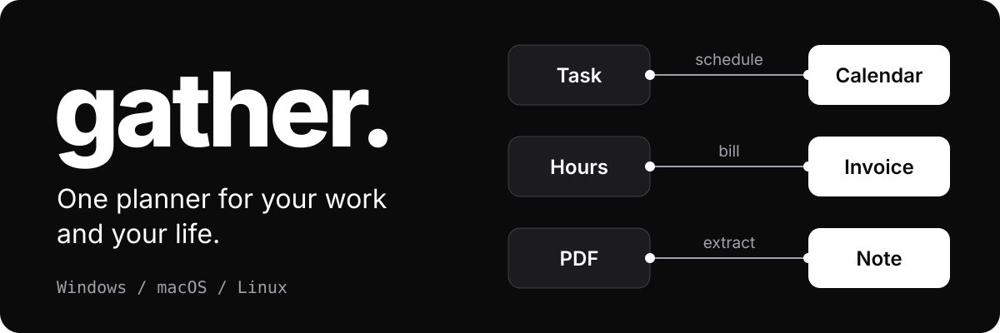
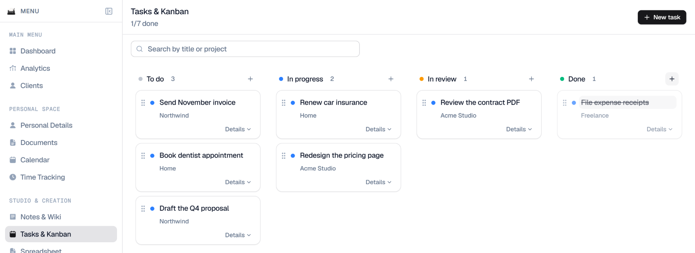
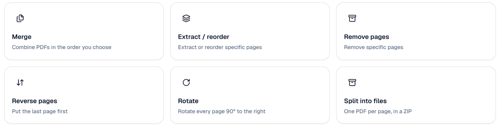

<p align="center">
  
</p>

<p align="center">
  <a href="https://github.com/stvekoulo/gather-suite/releases/latest"><strong>Download the latest version</strong></a>
  &nbsp;·&nbsp;
  <a href="#install">Install</a>
  &nbsp;·&nbsp;
  <a href="#build-from-source">Build from source</a>
</p>

<p align="center">
  
</p>
<p align="center"><sub>Sample data. Drag a card between columns, or schedule it on your calendar.</sub></p>

## What is Gather?

Gather is a desktop app that keeps your calendar, tasks, notes, documents, invoices and money in one place. It works offline, and your data stays on your computer unless you choose to create an account.

You can keep separate spaces, for example one for work and one for home.

## Your modules talk to each other

Most tools make you copy things from one app to the next. In Gather, the next step is a click away:

- **Task to calendar:** schedule a task, and it takes a slot in your calendar.
- **Hours to invoice:** track your time, then bill it.
- **PDF to note:** extract the text of a PDF, then keep it as a note.
- **Search everything:** `Ctrl+K` finds file names and the words inside your notes, tasks, invoices and clients as you type.
- **Capture from anywhere:** `Ctrl+Shift+Space` drops a note, task or event into Gather without leaving what you are doing.

## What's inside

| Plan | Create | Run your business |
| --- | --- | --- |
| Calendar | Notes and wiki | Clients |
| Tasks and Kanban | Documents | Invoices |
| Time tracking | Spreadsheets | Income and expenses, with live exchange rates |
| Dashboard and analytics | Presentations | |
| | Infinite canvas | |

The PDF suite has 21 tools that run on your computer, including merge, split, OCR, redaction and digital signatures.

<p align="center">
  
</p>

## Install

Download the file for your system from the [latest release](https://github.com/stvekoulo/gather-suite/releases/latest).

| System | File | Requires |
| --- | --- | --- |
| Windows | `_x64-setup.exe` | Windows 10 or 11, 64-bit |
| macOS, Apple Silicon | `_aarch64.dmg` | macOS 11 or newer |
| macOS, Intel | `_x64.dmg` | macOS 11 or newer |
| Linux | `.AppImage` or `.deb` | Ubuntu 22.04 or newer, x86_64 |

The installers are not code-signed yet, so your system will warn you:

- **Windows:** on the SmartScreen warning, choose **More info**, then **Run anyway**.
- **macOS:** move Gather to Applications, then run:

  ```sh
  xattr -cr /Applications/Gather.app
  ```

## Your data

- **On your computer:** everything is stored in a local database, with a daily snapshot kept for 7 days. You can export and restore all your spaces from **Settings > Data**.
- **Optional account:** notes, tasks, events, finances, invoices and preferences sync between your computers. Each account can only reach its own data. Read [how sync works](docs/CLOUD.md).
- **AI assistants:** Gather has no AI built in. You can connect your own assistant through a [local MCP server](docs/MCP.md), which is off by default.
- **Online requests:** without an account, Gather only contacts `open.er-api.com` for exchange rates and `date.nager.at` for public holidays, plus any image you insert by web address.

## Known limits

- Imported files and attachments do not sync. Their names and details do, and so do documents you write in Gather.
- The macOS and Linux builds have not yet been tested on real machines.
- Part of the interface still appears in French when the language is set to English.

Test results are in [docs/VALIDATION.md](docs/VALIDATION.md). The project documents in `docs/` are written in French.

## Build from source

You need Node.js 24 LTS or 26, Rust 1.90 or newer, and the [Tauri v2 system dependencies](https://tauri.app/start/prerequisites/).

```sh
npm ci
npm run tauri:dev
```

Run the checks with:

```sh
npm test
npm run typecheck
npm run lint
npm run build
npm run test:e2e
```

To build the installers, run `npm run tauri:build`. Releases are described in [docs/RELEASE.md](docs/RELEASE.md).

## License

Copyright © 2026 Steven KOULO. All rights reserved. Gather is proprietary software: the source is visible here, but it is not open source. See [LICENSE](LICENSE). Third-party components keep their own licenses.
